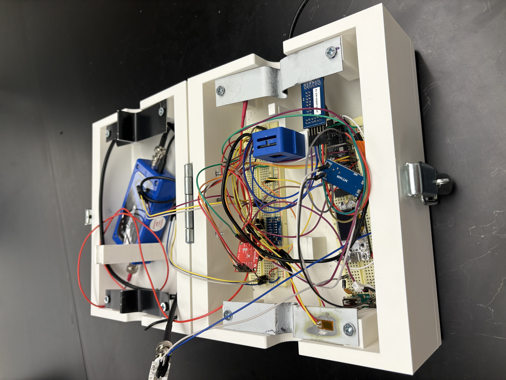
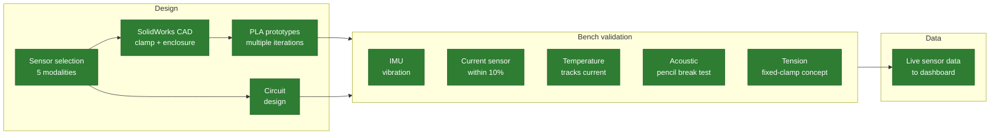
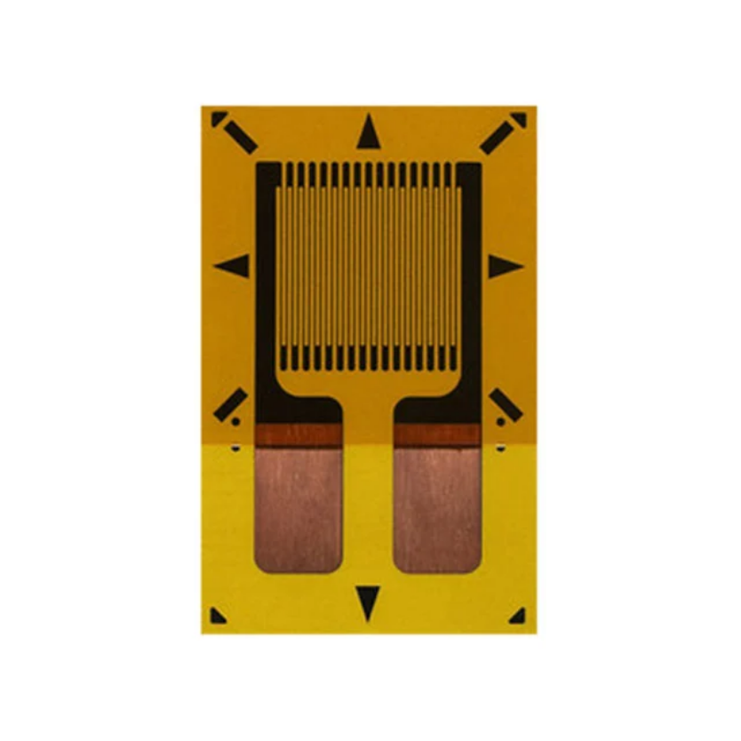
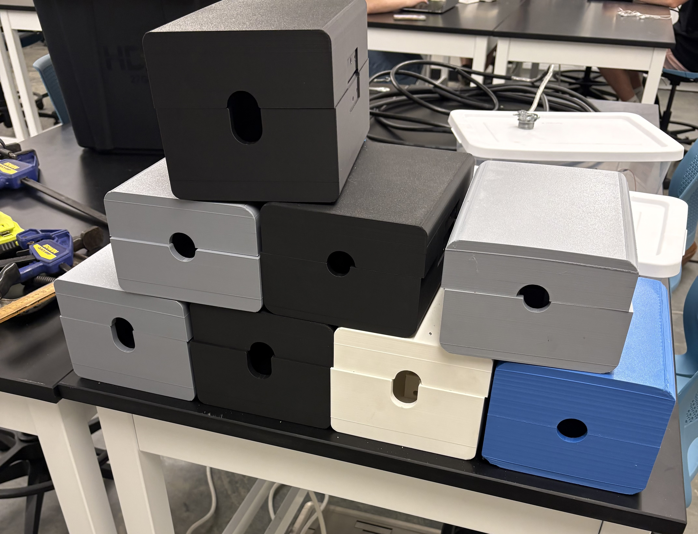
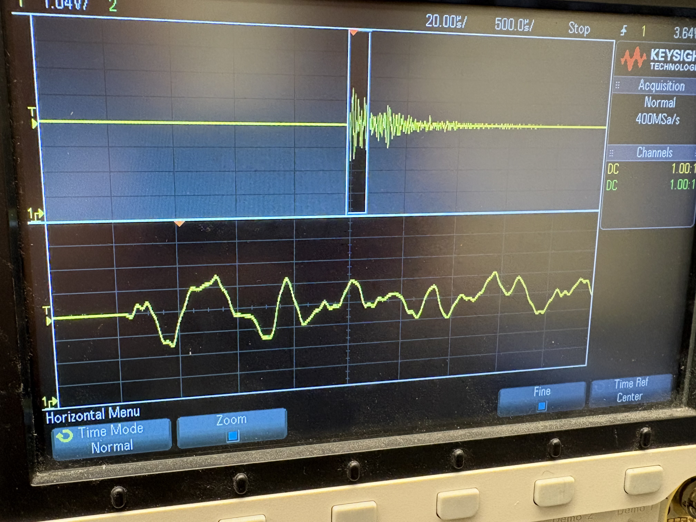

## LiveLine
**Real-Time Power-Line Fault Monitoring System**
 
INNOVATE: L3Harris Endowed Summer Program | Role: Systems Engineering Lead and Team Lead

A clamp-mounted sensor system that attaches to a power line and monitors 12 electrical and mechanical metrics to catch early signs of a developing fault before it causes an outage or wildfire.

 

*Prototype enclosure (left) and sensor circuit diagram (right). The strain gauge, mounted on the clamp body, is not shown in the circuit.*

## Status at a Glance

*Completed prototype: design, bench validation of each sensor, and live data streaming to the dashboard.*

## Key Results

- **Bench validation across all five modalities:** IMU, current, temperature, and acoustic sensors confirmed working; tension detection proven as a concept.
- **Current sensor accurate within 10%** against a watt meter reference, with line temperature rising in step with current draw.
- **Acoustic detection confirmed** with a Hsu-Nielsen pencil break test, producing a clear oscilloscope signal.
- **Live data dashboard:** sensor output streams to a dashboard showing real-time readings and line status.
- **Rapid design iteration:** SolidWorks clamp and enclosure taken through multiple 3D-printed prototypes, with a half-shell hinge for installation on live lines.

## Demos

https://github.com/user-attachments/assets/1eeec7b4-399e-44b4-9e49-9601d9c09212

*IMU vibration detection.*

https://github.com/user-attachments/assets/c27b1532-991c-4ed6-aec1-5699cf689674

*Tension detection on the fixed-clamp test setup.*

---

## Background

Power line failures leave roughly 34 million households without power and cost the U.S. economy an estimated $150 billion every year, and outages are getting more frequent and longer as the grid ages. Many failure modes could be prevented if utilities had live data on the line. A failed line can cut power to homes and hospitals, disable traffic systems, and in dry conditions spark a wildfire. Most lines still aren't monitored in real time, so developing faults are usually caught only after they cause damage.

This README separates the **full product vision** from **what has been validated in the current prototype.**

## Technical Details

### System Architecture

LiveLine fuses five sensing modalities into a single clamp-mounted enclosure, each targeting a different fault precursor:

| Sensor | Target Signal | Component | Photo |
|---|---|---|---|
| Strain Gauge | Tension, force, sag, stress, strain | CEA-13-250UWA-350 |  |
| IMU | Vibration, tilt, mechanical fatigue (via Miner's Rule) | QCIOT-ICM42688P |  |
| Temperature Sensor | Line temperature, ambient temperature | DS18B20 |  |
| Acoustic Sensor | Acoustic fault detection | Nano 30 |  |
| Current Sensor | Current detection | SCT-013 |  |

### CAD and Enclosure

The clamp and enclosure were designed in SolidWorks and 3D printed in PLA. The clamp uses a half-shell hinge for easy installation on live lines. The IMU, strain gauge, and acoustic sensor mount directly on the clamp body; the current and temperature sensors sit inside the PLA enclosure.

 

*CAD design (left) and the printed PLA enclosure (right).*

*Multiple printed prototypes from the design iteration process.*

### Live Data Dashboard

Live sensor data streams to a dashboard showing real-time readings, current line status, and a failure mode display. Model-based failure prediction is a future improvement.

*Dashboard with live data view, line status, and failure mode display.*

### Testing Scope

All testing so far was done on the bench, not on an energized line, which is standard at this stage. The current build uses an aluminum clamp for ease of prototyping; the next iteration moves to a non-conductive material with shielding and weatherproofing before any field deployment.

---

## Validation Log

### Vibration (IMU)

Verified functional (see the IMU demo under Demos).

### Current and Temperature

The current sensor was tested against a hot pot load on a watt meter and read within 10% of the reference. In the same test, line temperature rose in step with current draw, validating the temperature sensor.

*Hot pot plugged into a watt meter for a known reference, compared against the sensor's live output.*

### Acoustics (Nano 30)

Verified functional with a Hsu-Nielsen pencil break test, a standard way to generate a controlled acoustic emission event. The signal was clear on the oscilloscope. Characterizing real fault signatures is limited by the sensor's high sensitivity, which the next testing round addresses.

*Oscilloscope output from the pencil break test.*

### Tension

Large tension events were detected using a fixed-clamp test setup. This validated the sensing concept but not the final mechanical design (see the sliding-clamp redesign under Future Improvements; demo under Demos).

---

## Future Improvements

- **Sliding-clamp tension sensor:** the first prototype validated tension detection with a fixed test clamp, which doesn't represent field operation. The redesign keeps one clamp fixed while the second slides freely, with a linear potentiometer between them to measure strain along the line directly. Next step is to build and validate it.

  

- **Acoustic characterization:** resolve the sensor's high-sensitivity signal handling to validate real fault signatures.
- **Non-conductive clamp:** replace aluminum with a plastic that still transmits vibration to the IMU and acoustic sensor.
- **EMF shielding:** protect electronics from interference near energized lines.
- **IP68 weatherproofing:** move from PLA to a sealed, weather-rated polycarbonate enclosure.
- **Solar power:** long-duration unattended deployment without battery replacement.
- **Satellite communication:** remote data transmission without local network infrastructure.
- **AI failure prediction:** predict failure mode and timing from live sensor data.
- **Field validation:** test the full sensor suite against real fault conditions.
